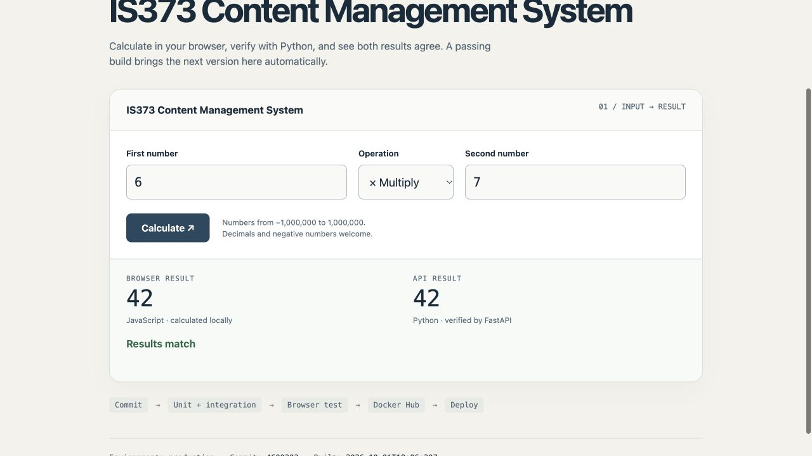
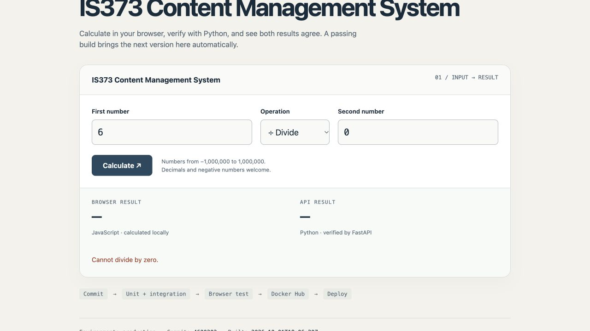

# Lesson 01 · Fresh-clone trial — October 27, 2026

[Contents](../../README.md) · [Student lesson](../../studio/lesson-01.md) ·
[STUDIO-001](../../SPEC.md#studio-001--launch-a-tested-calculator-on-an-existing-server) ·
[Instruction fixes, PR #11](https://github.com/kaw393939/373_hosting/pull/11)

This is instructor/operator validation of the self-paced onboarding, not a real
student's submission or evidence of learning. Scripted passive replies such as
“yes” and “do everything for me” did not become learner contributions; those
fields stayed Pending. The active template remains unfinished.

## First attempt: actual operations

A new template copy was SSH-cloned and its prepared setup created a fresh virtual
environment. Black, Pylint, 85 non-E2E tests and two real Docker/Chromium tests
passed. The read-only server doctor found fifteen existing containers and a
target ready for a new launch.

The first launch created the scoped calculator container, but its initial HTTPS
request encountered a self-signed certificate and was correctly rejected.
Later, ordinary trusted HTTPS returned the expected production health/commit.
The verifier's already-managed-deployment path then passed the selected image,
commit and production health checks, multiplication result 42, HTTP 400 for
division by zero and HTTP 422 for string input. The recorded preservation
comparison found the fifteen unrelated containers unchanged. Initial rejection,
later readiness and subsequent verification are distinct outcomes; the first
failure was not rewritten as an immediate successful launch.

Cleanup removed only the owned trial project and helper files; the other fifteen
containers remained unchanged. The trial repository was archived, and its local
virtual environment, runtime state and caches were removed. Public evidence is
preserved in the archived [TRIAL.md](https://github.com/kaw393939/is373-studio-trial-1027/blob/main/TRIAL.md)
and [sanitized runtime report](https://github.com/kaw393939/is373-studio-trial-1027/blob/main/studio/evidence.json).

## Findings and corrections

| Friction observed or reviewed | Correction in PR #11 |
|---|---|
| HTTPS could be checked before certificate readiness | Bounded 60-second trusted-TLS readiness and clearer failure messages; no disabled verification |
| Repeated JSON reports cluttered the terminal | Show each streamed runtime report once |
| Long historical specifications distracted from the first lesson | Concise STUDIO-001 agreement; complete instructor history retained separately |
| Agent GitHub access or final repository state could leave students guessing | Manual browser PR path, followed by pulling merged main and running status |
| Server Docker could be confused with local E2E capability | Explicit local fast-check/full-CI alternative; skipped checks are not passes |

The updated repository checks passed 91 non-E2E tests and two real-browser
tests. These are checks of the revision, not a second fresh-clone walkthrough.

## Second attempt

The [second copy](https://github.com/kaw393939/is373-studio-retry-1027) was created
from the revised main branch and freshly SSH-cloned. GitHub initially returned
an empty clone while template generation was in progress. Waiting for the README
and pulling main recovered it. The README now gives that short recovery step.
A new virtual environment setup, Black, Pylint, 91 non-E2E tests and two real
Docker/Chromium journeys passed from this separate clone.

Read-only doctor again found fifteen existing containers and an unused target.
At 06:39:30 UTC a successful new launch recorded `provenance: launched` and
`new_launch: true`. Repeat verification at 06:41:32 UTC correctly recorded
`already-managed`. Both reports are preserved: [new launch](https://github.com/kaw393939/is373-studio-retry-1027/blob/main/studio/launch-evidence.json)
and [repeat verification](https://github.com/kaw393939/is373-studio-retry-1027/blob/main/studio/evidence.json).
The chosen digest/production commit, trusted HTTPS, multiplication result 42,
zero-division 400, numeric-string 422 and fifteen-container preservation passed.
The coach now preserves a successful sanitized launch report before later verify
can replace the local current-observation file.

Real computer-use browser checks on the trial hostname found 42 in both result
areas and “Results match”; dividing by zero cleared both and showed “Cannot
divide by zero.” The initial browser open timed out in the automation tool, but
the already-created tab loaded and worked when rebound. This was an operator
tool boundary, not a calculator acceptance failure.

The cooperative dialogue was explicitly scripted: a partial request-path
prediction prompted a short Docker-network explanation; the next question asked
for ordinary SSH access. A plain “yes” was accepted for the explicit launch
plan. The coach then asked for interpretation of an actual 400 response, a
browser observation, and a keep/revise reason. [LEARNING.md](https://github.com/kaw393939/is373-studio-retry-1027/blob/main/LEARNING.md)
labels all learner replies synthetic and the browser actions as AI/operator work.
No actual student explanation or engagement has been established.

The [actual trial PR #2](https://github.com/kaw393939/is373-studio-retry-1027/pull/2)
passed all three jobs, merged at `5c4d31c110036074a5402f9ded5286807160c215`, and
closed its actual lesson issue. After pulling main, status withheld readiness
until the [merged-main run](https://github.com/kaw393939/is373-studio-retry-1027/actions/runs/40463083682)
also passed. It then reported evidence ready for instructor review, explicitly
not a grade or certification of understanding. A controlled unpublished edit
made readiness false; restoring the original record recovered a clean revision.
[Actual status snapshots](assets/studio-2026-10-27-status.json) preserve both cases.

The instructions now name the normal post-merge CI wait. The final workflow
runs on PRs and pushes to main, avoiding duplicate feature-branch push/PR runs
while retaining the three full jobs and merged-main verification.

Cleanup removed only this owned calculator project and helper files, again
verifying the fifteen other containers' selected identities, states and published
ports unchanged. Trusted HTTPS on the original classroom calculator still
returned its expected production health/commit (200); the retired trial route
returned 404. The disposable repository is archived with its evidence. Its
local virtual environment, runtime configuration and caches were removed; the
source-only clone was moved alongside the first retired trial. The active
template's LEARNING.md remains Pending and contains no trial completion.

## Evidence limits

The trial checks the recorded setup, selected hosted behavior and preservation
comparison. It does not establish an independent host rebuild, comprehensive
server security, every possible calculator input or actual student engagement.
AI coaching simulations can expose prompts that permit passive approval; they
cannot establish that students learned. GitHub timestamps and artifacts record
activity and results, separately from learner explanations.
